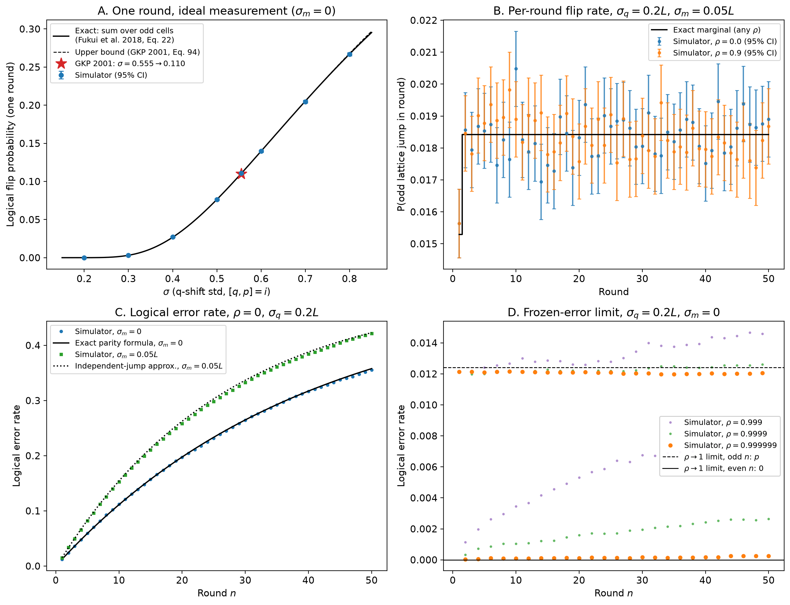

# Validation of the GKP simulator (`simulator/sim.py`)

This note states the model `sim.py` simulates, derives every reference value
used to test it, says where each one comes from (closed form or published
result), and compares the simulator against them.

Reproduce everything (figure and table) from the repo root:

```bash
python -m experiments.validate_sim
```



---

## 1. Model

**Conventions.** Dimensionless quadratures with $[\hat q,\hat p]=i$ ($\hbar=1$).
Square GKP code with stabilizer $S_q=e^{2i\sqrt\pi\,\hat q}$ and lattice spacing

$$L=\sqrt\pi .$$

Logical $|\bar 0\rangle$ has position peaks at $q=2nL$ and $|\bar 1\rangle$ at
$q=(2n+1)L$. So a shift by $2L$ is a stabilizer (no effect), a shift by $L$ is
the logical $\bar X$, and a shift $|r|<L/2$ is correctable.
This is the convention of Gottesman–Kitaev–Preskill [1], and every $\sigma$
below is the standard deviation of the physical $q$-shift in that convention
(see §5 on the $\sqrt2$ difference in Grimsmo–Puri [3]).

**Noise** (`simulator/noise.py`, `NoiseModel`). For trial $i$ and round
$t=1,\dots,T$:

$$
\varepsilon_1\sim\mathcal N(0,\sigma_q^2),\qquad
\varepsilon_t=\rho\,\varepsilon_{t-1}+\eta_t,\quad
\eta_t\sim\mathcal N\!\big(0,\sigma_q^2(1-\rho^2)\big),
$$
$$
\nu_t\sim\mathcal N(0,\sigma_m^2)\ \text{i.i.d.}
$$

so $\operatorname{Var}\varepsilon_t=\sigma_q^2$ for every $t$ and every
$\rho\in(-1,1)$ (stationary AR(1)).

**Error-correction round** (`Simulator.run`). With residual $x_0=0$:

$$
\begin{aligned}
x^{\text{pre}}_t &= x_{t-1}+\varepsilon_t &&\text{(displacement error)}\\
s_t &= \operatorname{wrap}(x^{\text{pre}}_t+\nu_t) &&\text{(noisy syndrome)}\\
c_t &= \mathcal D(s_1,\dots,s_t) &&\text{(decoder)}\\
x_t &= x^{\text{pre}}_t-c_t &&\text{(correction)}
\end{aligned}
$$

with $\operatorname{wrap}(y)=y-L\,\operatorname{round}(y/L)\in[-L/2,L/2)$.

**Logical error after round $t$.** Write $x_t=k_tL+r_t$ with
$k_t=\operatorname{round}(x_t/L)$ and $|r_t|<L/2$. One ideal final correction
removes $r_t$, and $k_tL$ applies $\bar X^{k_t}$. So

$$
\text{logical error after round } t \iff k_t \text{ is odd}.
$$

The logical error rate is $P_{\text{L}}(t)=\Pr[k_t\ \text{odd}]$
(`SimResult.logical_error_rate`). The lattice jump in round $t$ is
$\Delta k_t=k_t-k_{t-1}$ (`SimResult.lattice_jumps`).

The **nearest-lattice decoder** sets $c_t=s_t$.

---

## 2. Closed-form results for the nearest-lattice decoder

Let $\Phi$ be the standard normal CDF and define, for $Z\sim\mathcal N(0,\sigma^2)$,

$$
\boxed{\;p(\sigma)\;=\;\Pr\!\big[\operatorname{round}(Z/L)\ \text{odd}\big]
=\sum_{j\ \text{odd}}\Big[\Phi\!\Big(\tfrac{(j+\frac12)L}{\sigma}\Big)
-\Phi\!\Big(\tfrac{(j-\frac12)L}{\sigma}\Big)\Big]\;}
\tag{P}
$$

(`sim.odd_jump_probability`). Since the cells $|j|\ge3$ are exponentially
small, $p(\sigma)\approx 2\big[1-\Phi(L/2\sigma)\big]=\operatorname{erfc}\!\big(L/(2\sqrt2\,\sigma)\big)$,
and this tail is also an upper bound on $p(\sigma)$.

### Proposition 1: single round, ideal measurement
With $\sigma_m=0$ and one round, a logical error happens with probability
$p(\sigma_q)$.

*Proof.* $x^{\text{pre}}_1=\varepsilon_1$, $c_1=\operatorname{wrap}(\varepsilon_1)$,
so $x_1=L\operatorname{round}(\varepsilon_1/L)$ and $k_1=\operatorname{round}(\varepsilon_1/L)$. $\square$

*Literature.* (P) is the incorrect-decision probability of Fukui et al. [2],
Eq. (22), at cutoff $v_{\text{up}}=0$. GKP [1], Eq. (94), gives the bound
$p_e<\operatorname{erfc}(\sqrt\pi/(2\sqrt2\sigma))$ and evaluates it as
$0.110$ at $\sigma\approx0.555$. Both use the same $\sigma$ convention and the
same $\sqrt\pi$ lattice as here.

### Lemma 2: residual after a nearest-lattice correction
For any noise realisation,

$$
x_t = L\,\operatorname{round}\!\big((x^{\text{pre}}_t+\nu_t)/L\big)-\nu_t .
$$

*Proof.* $x_t=x^{\text{pre}}_t-\operatorname{wrap}(x^{\text{pre}}_t+\nu_t)
=x^{\text{pre}}_t-(x^{\text{pre}}_t+\nu_t)+L\operatorname{round}(\cdot)$. $\square$

So after every round the oscillator sits on a lattice point displaced by minus
that round's measurement error. If $|\nu_t|<L/2$, which holds almost surely here
($\sigma_m=0.05L$), then $k_t=\operatorname{round}((x^{\text{pre}}_t+\nu_t)/L)$.

*Status.* This follows directly from the model by algebra. We did not find
it stated in this form in [1–3]. Grimsmo–Puri [3] (Fig. 10, Sec. III.2) describe
the related fact that a measurement error leaves a small displacement after
correction.

### Proposition 3: per-round flip probability (any $\rho$)
$$
\Delta k_t=\operatorname{round}(z_t/L),\qquad
z_t=\varepsilon_t+\nu_t-\nu_{t-1}\quad(\nu_0\equiv0),
$$
so

$$
\Pr[\Delta k_t\ \text{odd}]=
\begin{cases}
p\big(\sqrt{\sigma_q^2+\sigma_m^2}\big), & t=1,\\[2pt]
p\big(\sqrt{\sigma_q^2+2\sigma_m^2}\big), & t\ge2.
\end{cases}
$$

*Proof.* Substitute $x_{t-1}=k_{t-1}L-\nu_{t-1}$ (Lemma 2) into
$x^{\text{pre}}_t$ and use that $k_{t-1}L$ is a multiple of $L$. $z_t$ is a sum
of independent Gaussians, $\varepsilon_t$ has variance $\sigma_q^2$ for every
$\rho$, and $\nu_t,\nu_{t-1}$ are independent of it. $\square$

This is a statement about **one round's marginal** only. For $\rho\ne0$ the
jumps $\Delta k_t$ of different rounds are correlated.

### Proposition 4: logical error rate when jumps are independent
If the parities of $\Delta k_1,\dots,\Delta k_n$ are independent with
probabilities $p_1,\dots,p_n$, then

$$
P_{\text{L}}(n)=\tfrac12\Big[1-\prod_{t=1}^n(1-2p_t)\Big].
$$

*Proof.* $k_n=\sum_t\Delta k_t$, and
$\mathbb E[(-1)^{k_n}]=\prod_t\mathbb E[(-1)^{\Delta k_t}]=\prod_t(1-2p_t)$. $\square$

(This is the standard parity / "piling-up" identity for independent bits.)

- **Exact** for $\rho=0,\ \sigma_m=0$: then $z_t=\varepsilon_t$ are i.i.d., so
  $P_{\text{L}}(n)=\frac12[1-(1-2p(\sigma_q))^n]$.
- **Approximate** for $\rho=0,\ \sigma_m>0$: $z_t$ and $z_{t+1}$ share $\nu_t$
  with opposite signs, so
  $\operatorname{corr}(z_t,z_{t+1})=-\sigma_m^2/(\sigma_q^2+2\sigma_m^2)\approx-0.056$
  for the default parameters. We use $p_1=p(\sqrt{\sigma_q^2+\sigma_m^2})$ and
  $p_{t\ge2}=p(\sqrt{\sigma_q^2+2\sigma_m^2})$.
- **Not valid** for $\rho\ne0$. No closed form is claimed there.

### Proposition 5: frozen-error limit $\rho\to1$, $\sigma_m=0$
If $\varepsilon_t\equiv\varepsilon$ for all $t$, then every round jumps by
$\operatorname{round}(\varepsilon/L)$, so $k_n=n\operatorname{round}(\varepsilon/L)$ and

$$
P_{\text{L}}(n)=\begin{cases}p(\sigma_q), & n\ \text{odd},\\ 0, & n\ \text{even}.\end{cases}
$$

The simulator requires $|\rho|<1$, so this is checked as a limit by
taking $\rho\to1$.

---

## 3. Results

Parameters unless noted: $\sigma_q=0.2L$, $\sigma_m=0.05L$; 200 000 trials
(check A) or 50 000 trials (B–D); seed 2026.
$z=(\hat p-p)/\sqrt{p(1-p)/N}$, using the reference $p$.

| Check | Case | Simulated | Reference | z | Reference type |
|---|---|---|---|---|---|
| A single round (Prop. 1) | σ=0.200 | 0.00001 | 0.00001 | −0.64 | exact |
| | σ=0.300 | 0.00298 | 0.00314 | −1.21 | exact |
| | σ=0.400 | 0.02739 | 0.02672 | +1.87 | exact |
| | σ=0.500 | 0.07616 | 0.07632 | −0.26 | exact |
| | **σ=0.555** | **0.11076** | **0.11031** (GKP: 0.110) | +0.64 | exact + literature |
| | σ=0.600 | 0.13967 | 0.13965 | +0.01 | exact |
| | σ=0.700 | 0.20458 | 0.20535 | −0.86 | exact |
| | σ=0.800 | 0.26687 | 0.26707 | −0.20 | exact |
| B per-round flip (Prop. 3) | ρ=0, round 1 | 0.01564 | 0.01529 | +0.63 | exact |
| | ρ=0, mean of rounds 2–50 | 0.01837 | 0.01842 | −0.66 | exact |
| | ρ=0.9, round 1 | 0.01564 | 0.01529 | +0.63 | exact |
| | ρ=0.9, mean of rounds 2–50 | 0.01834 | 0.01842 | −1.01 | exact |
| C1 logical error rate, ρ=0, σ_m=0 (Prop. 4) | worst of 50 rounds (47) | 0.34344 | 0.34669 | −1.53 | exact |
| | round 50 | 0.35562 | 0.35783 | −1.03 | exact |
| C2 logical error rate, ρ=0, σ_m=0.05L (Prop. 4) | round 50 | 0.42174 | 0.42298 | −0.56 | approx. |
| D ρ→1 limit, σ_m=0 (Prop. 5) | ρ=0.999 odd / even n | 0.01330 / 0.00561 | 0.01242 / 0 | | limit |
| | ρ=0.9999 odd / even n | 0.01230 / 0.00174 | 0.01242 / 0 | | limit |
| | ρ=0.99999 odd / even n | 0.01207 / 0.00052 | 0.01242 / 0 | | limit |
| | ρ=0.999999 odd / even n | 0.01207 / 0.00015 | 0.01242 / 0 | | limit |

Notes on reading the table:

- **A (panel A).** All eight points are within $2\sigma$. At $\sigma=0.555$ the
  exact sum (P) equals the GKP bound to four decimals (0.1103). The bound
  also counts the even cells $|j|\ge2$, but they only add
  $1.7\times10^{-6}$. That matches GKP's quoted 0.110.
- **B (panel B).** In round 1 the two $\rho$ values give the same number on
  purpose: the two runs share a seed, and $\varepsilon_1$ does not depend on
  $\rho$. The pooled $z$ for rounds 2–50 treats rounds as independent, which
  they are not, so it is only indicative. Looking round by round, the most
  extreme of the 49 rounds is $|z|=3.42$ for $\rho=0$ (Bonferroni
  $p=0.03$) and $|z|=2.32$ for $\rho=0.9$ ($p=0.99$). Rerunning $\rho=0$ with
  three other seeds gave max $|z|$ of 2.60, 3.30 and 2.96, while the means of
  rounds 2–50 stayed between 0.01835 and 0.01840 (exact 0.01842). Our reading
  is that this is chance from taking the most extreme of 49 rounds, not a bias.
- **C (panel C).** With $\sigma_m=0$ the simulator follows the exact curve
  over all 50 rounds. With $\sigma_m>0$ it sits slightly *below* the
  independent-jump approximation. That is the expected direction: the
  negatively correlated $z_t,z_{t+1}$ make jumps pair up as $+1,-1$, which
  cancel in parity.
- **D (panel D).** The odd-round rate tends to $p(\sigma_q)=0.0124$ and the
  even-round rate tends to 0. The leftover even-round rate shrinks by
  $\approx\sqrt{10}$ for every factor of 10 in $1-\rho$, which is consistent
  with drift of $\varepsilon_t$ at rate $\sigma_q\sqrt{1-\rho^2}$ per round.

**Conclusion.** Every closed-form or literature value in this note is
reproduced within statistical error. Where only an approximation or a limit
exists, the simulator deviates in the predicted direction and converges as
predicted.

---

## 4. What is *not* validated here

- The logical error rate for $0<\rho<1$ over many rounds has **no closed form**
  in this note. Those curves (e.g. the drop from 0.425 at $\rho=0$ to 0.247 at
  $\rho=0.9$ after 50 rounds) rely on the simulator itself. They are
  consistent with Props. 3–5, which cover the marginal and both ends
  $\rho=0$ and $\rho\to1$.
- Decoders other than nearest-lattice and no-correction.
- Anything beyond the classical shift model: finite-energy (Δ) effects,
  noise in the $p$ quadrature, ancilla noise in the extraction circuit, loss.
  `quantum/encoding.py` is the starting point for checking the shift model
  against QuTiP.

---

## 5. Sources and conventions

| Ref. | Used for | Location | σ convention |
|---|---|---|---|
| [1] GKP 2001 | Bound and the value 0.110 at σ=0.555 | Sec. VIII, Eqs. (94)–(95) | std of physical q-shift, $[q,p]=i$, $\hbar=1$ (same as here) |
| [2] Fukui et al. 2018 | Exact odd-cell sum (P) | Sec. III.2, Eq. (22) with $v_{\text{up}}=0$ | std of q-deviation, $\sqrt\pi$ lattice (inferred, not stated) |
| [3] Grimsmo & Puri 2021 | Code conventions, residual-shift picture | Eqs. (4), (5a), (26); Sec. III.2; Fig. 10 | σ is per component of ζ in $D(\zeta)$; **physical q-std is $\sqrt2\,\sigma$** |

Props. 2–5 and their proofs are derived here from the model in §1. We checked
[1]–[3] and did not find them stated there in this form.

Equation and section numbers were read from the arXiv HTML versions below
(GKP v3; Fukui v3, first half verbatim; Grimsmo–Puri v1). Check them against
the journal versions before citing.

1. D. Gottesman, A. Kitaev, J. Preskill, "Encoding a qubit in an oscillator,"
   *Phys. Rev. A* **64**, 012310 (2001).
   [arXiv:quant-ph/0008040](https://arxiv.org/abs/quant-ph/0008040)
2. K. Fukui, A. Tomita, A. Okamoto, K. Fujii, "High-threshold fault-tolerant
   quantum computation with analog quantum error correction,"
   *Phys. Rev. X* **8**, 021054 (2018).
   [arXiv:1712.00294](https://arxiv.org/abs/1712.00294)
3. A. L. Grimsmo, S. Puri, "Quantum error correction with the
   Gottesman–Kitaev–Preskill code," *PRX Quantum* **2**, 020101 (2021).
   [arXiv:2106.12989](https://arxiv.org/abs/2106.12989)
